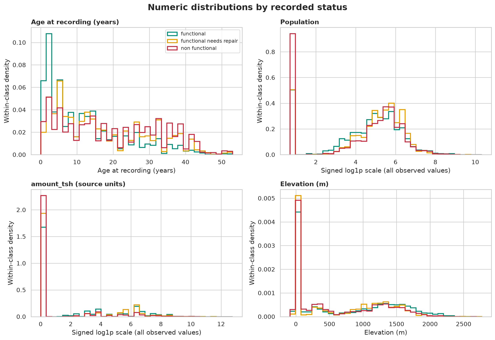
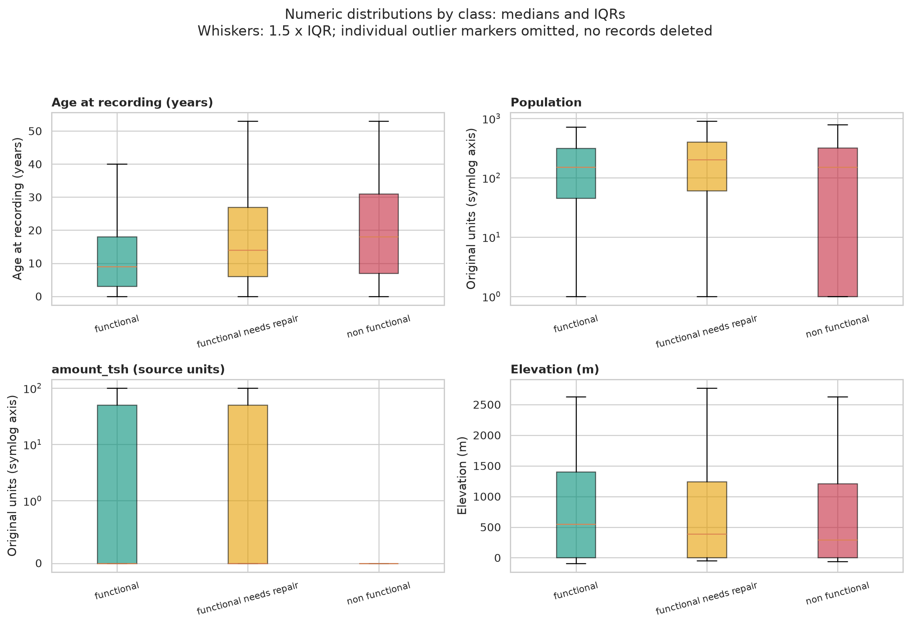
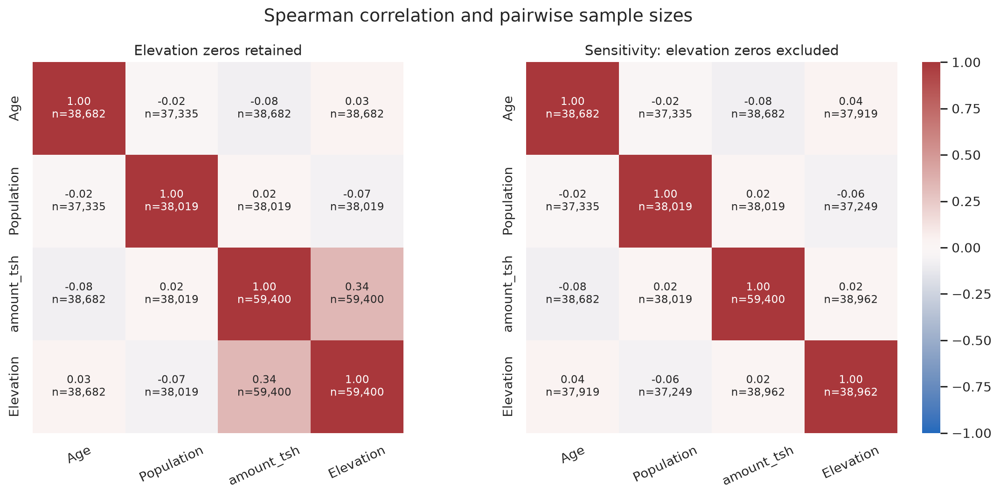
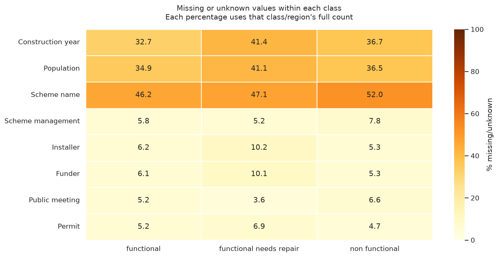
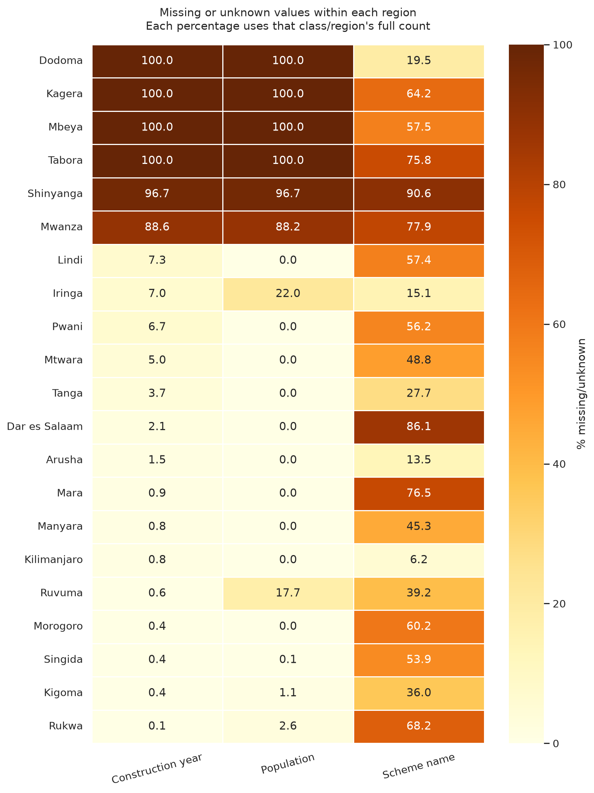
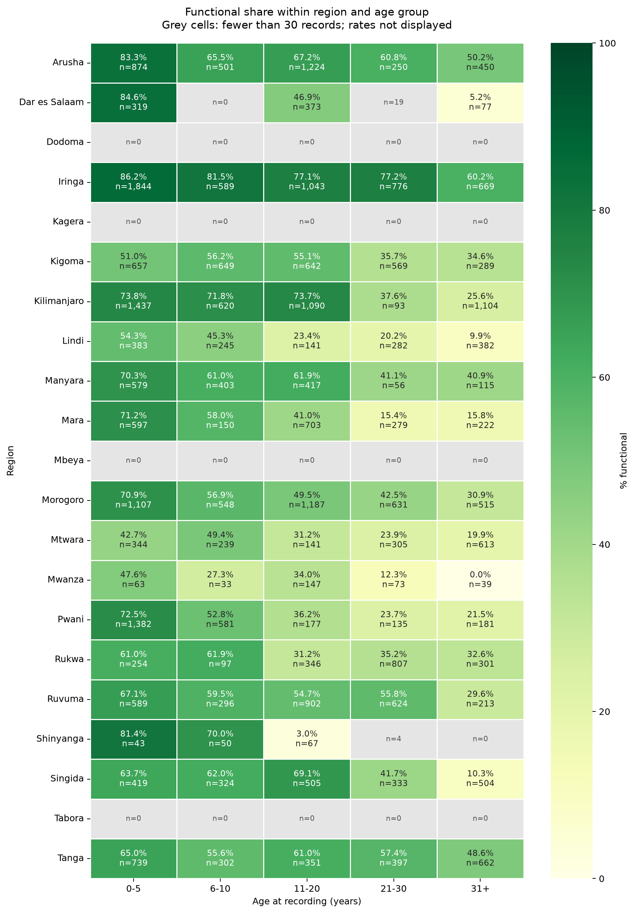
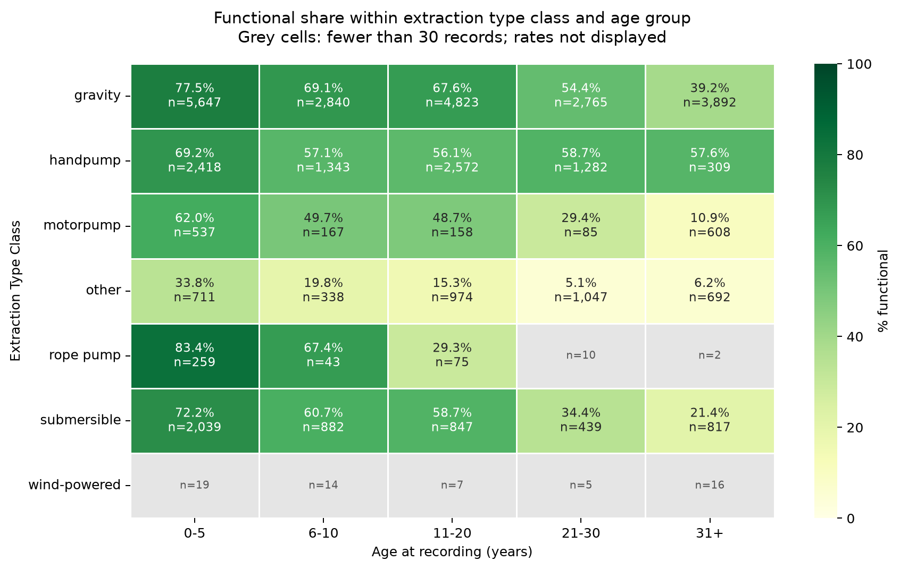

# Additional Sprint 1 EDA

Analysis run: 15 October 2026. Scope: numeric distributions and correlations, missingness by target class and region, and age comparisons within regions and broad extraction classes.

## Main findings

- Construction year is unknown for all records in Dodoma, Kagera, Mbeya, Tabora. These four regions contribute 12,115 of 59,400 records (20.4%) and do not enter the age analysis.
- Unknown years and population values are more common in the repair class than in the functional class. The age subset has a different target mix from the records with unknown years.
- Among the four selected numeric predictors, the largest absolute Spearman correlation is between amount_tsh and elevation (0.342). It becomes 0.022 when zero elevations are excluded. This relationship is sensitive to how zero elevations are handled and which records are included.
- The youngest age group has a higher functional share than the oldest group in all 16 eligible regions and all five eligible extraction classes. Rates across the intermediate age bands are often non-monotonic.
- Applying a common region mix reduces the youngest-minus-oldest gap from 40.1 to 37.2 percentage points. Applying a common extraction-class mix reduces its corresponding gap from 39.9 to 36.2 points. Each comparison uses the same eligible strata for its pooled and standardized results.

## What was added

- A reusable analysis module: [additional_eda.py](../../src/team_wtm/additional_eda.py).
- An executed notebook: [04_additional_numeric_missingness_age_eda.ipynb](../../notebooks/04_additional_numeric_missingness_age_eda.ipynb).
- Seven figures and an [aggregate JSON summary](additional_eda/summary.json).
- Tests for age boundaries and exclusions, missingness denominators, pairwise correlation counts, elevation sensitivity, absent age strata, sample thresholds, and standardization.

## Data and preparation

The original training features and labels are joined by validated, unique IDs. All 59,400 records are retained. The existing [shared cleaner](../../src/team_wtm/cleaning.py) converts zero population and construction year to missing values and parses the recording date. Its defaults are reused without changes. Duplicate observations remain under the [audit policy](data_quality_findings.md).

Age is the recording year minus construction year. Unknown or nonpositive construction years, missing/unparseable recording dates, and negative derived ages cannot supply usable ages. The raw input is preserved. Nonzero construction years are not rewritten; only the derived age is missing for these cases.

| Age coverage | Records |
| --- | --- |
| All training records | 59,400 |
| Usable age | 38,682 |
| Unknown construction year | 20,709 |
| Invalid known age | 9 |

The nine invalid known ages in these inputs are negative. Age bins are 0-5, 6-10, 11-20, 21-30 and 31+ years. The original inputs contain integer construction and recording years.

Elevation and amount zeros remain observed values in the primary analysis. Negative elevations are also retained. The elevation sensitivity scenario masks only zero elevations. It does not establish that every zero is missing and does not modify the shared cleaner.

## Numeric distributions and correlations

Only pump_age, population, amount_tsh and gps_height enter the numeric matrices. Identifiers, numeric category codes and status_group are excluded. The three target classes have no imposed numeric order. Construction year is omitted from the matrix because age is derived from it and recording year.

Numeric summaries include valid and missing counts, zeros, negative values, minimum, 1st/25th/50th/75th/99th percentiles and maximum. Selected medians are shown below; full ranges and denominators are in the JSON and notebook.

| Feature | Functional median (n) | Needs repair median (n) | Non-functional median (n) |
| --- | --- | --- | --- |
| pump_age | 9.0 (21,700) | 14.0 (2,528) | 18.0 (14,454) |
| population | 150.0 (20,985) | 200.0 (2,542) | 150.0 (14,492) |
| amount_tsh | 0.0 (32,259) | 0.0 (4,317) | 0.0 (22,824) |
| gps_height | 550.0 (32,259) | 385.0 (4,317) | 293.0 (22,824) |

Pump age has a median of 9 years among functional records, 14 among records needing repair, and 18 among non-functional records with usable ages. Population interquartile ranges overlap substantially. amount_tsh has a median of zero in all three classes, so its distributions need more than a comparison of medians. Very large population and amount values remain in the analysis and require source interpretation before any clipping or model transformation. The amount field is reported in source units without assuming that it measures a maintenance charge.



Histograms share bin edges within each feature and normalize each class separately. Population and amount use sign(x) * log(1 + abs(x)) for display. Values are not trimmed. The y-axis is density on the displayed scale; it does not show class prevalence.



Boxplots retain original values and use a symmetric log axis for population and amount. The boxes show the median and interquartile range. Whiskers follow the 1.5-IQR rule; individual outlier markers are hidden for readability. No records are removed.

Spearman is the primary correlation measure. Pearson coefficients are also saved in the JSON and use the same pairwise-available observations. Neither measure establishes predictive usefulness or causation. No correlation significance tests are used.



The amount-elevation coefficient falls from 0.342 (n=59,400) to 0.022 (n=38,962). The sensitivity scenario excludes 20,438 zero-elevation records from comparisons involving elevation. This changes the observed sample as well as the values used in those correlations. It is evidence of sensitivity, not proof of a specific recording error.

Other off-diagonal Spearman coefficients in the primary matrix have absolute values below 0.09. These selected predictors show little pairwise monotonic association, but nonlinear relationships, categorical redundancy and joint predictive effects remain possible.

## Missingness by class and region

Each percentage below uses all records in its class or region. Population/year zeros count as unknown after shared cleaning. For the other six columns, these are actual nulls. Textual values such as 'unknown', '0' and '-' are not silently combined with nulls. Missingness mechanisms cannot be classified as MAR or MNAR from these descriptive tables alone.

| Feature | Functional missing % | Needs repair missing % | Non-functional missing % |
| --- | --- | --- | --- |
| construction_year | 32.7 | 41.4 | 36.7 |
| population | 34.9 | 41.1 | 36.5 |
| scheme_name | 46.2 | 47.1 | 52.0 |
| scheme_management | 5.8 | 5.2 | 7.8 |
| installer | 6.2 | 10.2 | 5.3 |
| funder | 6.1 | 10.1 | 5.3 |
| public_meeting | 5.2 | 3.6 | 6.6 |
| permit | 5.2 | 6.9 | 4.7 |

Construction year is unknown for 41.4% of the repair class and 32.7% of the functional class. Population is unknown for 41.1% and 34.9%, respectively. Installer/funder nulls are also more common in the repair class. Indicators for missingness may therefore be worth evaluating within training-fold preprocessing, while checking whether recording patterns generalize.



Regional missingness is strongly structured. Dodoma, Kagera, Mbeya and Tabora have no known construction years or populations under the agreed zero-placeholder rule. Construction year is also unknown for 96.7% of Shinyanga and 88.6% of Mwanza. Complete-age results have limited coverage of these regions.



Target composition among age-availability groups:

| Age availability | Records | Functional % | Needs repair % | Non-functional % |
| --- | --- | --- | --- | --- |
| Invalid year/date/age | 9 | 44.4 | 0.0 | 55.6 |
| Unknown construction year | 20,709 | 51.0 | 8.6 | 40.4 |
| Usable age | 38,682 | 56.1 | 6.5 | 37.4 |

The nine invalid-age records are shown for completeness and are too few for a stable group comparison. Unknown-year records have a 51.0% functional share versus 56.1% in the usable-age subset. Complete-age summaries should therefore be described as results for the observed-age subset rather than assumed representative of the whole training set.

## Age comparisons within strata

All three target counts and percentages are saved for every stratum/age cell. Figures show functional share with the cell denominator. All 21 regions and seven extraction classes remain in the tables, including regions with no usable ages.

Rates for cells with fewer than 30 records are hidden in the heatmaps; the counts remain visible. The youngest-versus-oldest comparison requires at least 30 records in both extreme age groups. This threshold is a reporting rule and does not guarantee precise estimates. The aggregate JSON retains all cell counts and rates for transparent review.



Among 16 eligible regions, the youngest group has a higher functional share in all 16. Four regions have no usable ages and Shinyanga has no 31+ group. Only three of the 15 regions with at least 30 observations in every age bin have non-increasing functional shares across all five bins. The pooled monotonic pattern does not describe every region.

| Region | 0-5 n | 0-5 functional % | 31+ n | 31+ functional % | Gap (pp) | Eligible |
| --- | --- | --- | --- | --- | --- | --- |
| Arusha | 874 | 83.3 | 450 | 50.2 | 33.1 | yes |
| Dar es Salaam | 319 | 84.6 | 77 | 5.2 | 79.4 | yes |
| Dodoma | 0 | - | 0 | - | - | no |
| Iringa | 1,844 | 86.2 | 669 | 60.2 | 25.9 | yes |
| Kagera | 0 | - | 0 | - | - | no |
| Kigoma | 657 | 51.0 | 289 | 34.6 | 16.4 | yes |
| Kilimanjaro | 1,437 | 73.8 | 1,104 | 25.6 | 48.2 | yes |
| Lindi | 383 | 54.3 | 382 | 9.9 | 44.4 | yes |
| Manyara | 579 | 70.3 | 115 | 40.9 | 29.4 | yes |
| Mara | 597 | 71.2 | 222 | 15.8 | 55.4 | yes |
| Mbeya | 0 | - | 0 | - | - | no |
| Morogoro | 1,107 | 70.9 | 515 | 30.9 | 40.0 | yes |
| Mtwara | 344 | 42.7 | 613 | 19.9 | 22.8 | yes |
| Mwanza | 63 | 47.6 | 39 | 0.0 | 47.6 | yes |
| Pwani | 1,382 | 72.5 | 181 | 21.5 | 51.0 | yes |
| Rukwa | 254 | 61.0 | 301 | 32.6 | 28.5 | yes |
| Ruvuma | 589 | 67.1 | 213 | 29.6 | 37.5 | yes |
| Shinyanga | 43 | 81.4 | 0 | - | - | no |
| Singida | 419 | 63.7 | 504 | 10.3 | 53.4 | yes |
| Tabora | 0 | - | 0 | - | - | no |
| Tanga | 739 | 65.0 | 662 | 48.6 | 16.3 | yes |

A gap is youngest minus oldest. Ineligible rows are retained for coverage; their gaps should not be used as evidence of a reliable age contrast.



Five extraction classes meet the threshold in both extreme age groups, and all five have a higher functional share in the youngest group. Handpumps show a smaller extreme-age gap (11.6 percentage points) than motorpumps (51.2 points). Rope-pump and wind-powered oldest groups are too small for this comparison. Three of the five classes with sufficient counts in every bin have non-increasing rates across all bins.

| Extraction class | 0-5 n | 0-5 functional % | 31+ n | 31+ functional % | Gap (pp) | Eligible |
| --- | --- | --- | --- | --- | --- | --- |
| gravity | 5,647 | 77.5 | 3,892 | 39.2 | 38.3 | yes |
| handpump | 2,418 | 69.2 | 309 | 57.6 | 11.6 | yes |
| motorpump | 537 | 62.0 | 608 | 10.9 | 51.2 | yes |
| other | 711 | 33.8 | 692 | 6.2 | 27.5 | yes |
| rope pump | 259 | 83.4 | 2 | 50.0 | 33.4 | no |
| submersible | 2,039 | 72.2 | 817 | 21.4 | 50.8 | yes |
| wind-powered | 19 | 47.4 | 16 | 18.8 | 28.6 | no |

### A common stratum mix

For each eligible stratum s, the weight is (youngest_n_s + oldest_n_s) / sum_s(youngest_n_s + oldest_n_s). The standardized rate is the weighted average of the stratum-specific rates, with the same weights used for both age groups. The pooled comparison is restricted to those same eligible strata. Intermediate ages do not enter these extreme-age weights.

| Stratification | Eligible strata | Extreme-age records | Pooled young % | Pooled old % | Pooled gap (pp) | Standardized young % | Standardized old % | Standardized gap (pp) |
| --- | --- | --- | --- | --- | --- | --- | --- | --- |
| region | 16 | 17,923 | 71.5 | 31.4 | 40.1 | 70.1 | 32.9 | 37.2 |
| extraction_type_class | 5 | 17,670 | 71.3 | 31.4 | 39.9 | 70.9 | 34.7 | 36.2 |

The direction of the extreme-age association persists under each of these separate standardizations. They do not jointly account for region and technology, measurement differences, installation cohort, maintenance, water availability or other variables. These comparisons are not a causal estimate of ageing and cannot track individual deterioration.

## Implications for Sprint 2

- Retain age as a candidate feature, with an explicit unavailable-age indicator and training-fold imputation or a model that can handle missing values. Preserve source years while reviewing invalid ages.
- Evaluate missingness indicators and check performance by region and missing-age group. Four regions have no observed-age coverage.
- Review elevation zeros and compare documented treatments in validation. Avoid treating the primary amount-elevation coefficient as a stable physical relationship.
- Consider transformations for skewed population and amount values after confirming field meanings. Fit learned preprocessing on training folds.
- Continue checking every target class, especially needs repair. The age subset underrepresents that class relative to records with unknown years.

## Reproduce the work

From projects/water_pumps/team-WTM, with the original CSVs in data/raw/:

```bash
uv sync
uv run python -m team_wtm.additional_eda
uv run jupyter nbconvert --execute --to notebook --inplace --ExecutePreprocessor.timeout=300 notebooks/04_additional_numeric_missingness_age_eda.ipynb
uv run pytest
uv run ruff check src/team_wtm/additional_eda.py tests/test_additional_eda.py notebooks/04_additional_numeric_missingness_age_eda.ipynb
```

The CLI supports --values, --labels, --output-dir, --figures-dir and --min-cell-n.
By default, the aggregate summary is written to
`reports/sprint1/additional_eda/summary.json` and the seven PNG figures to
`reports/figures/additional_eda/`. `--output-dir` selects the directory for the
JSON summary; `--figures-dir` independently selects the directory for the figures.
To redirect a whole run, supply both options:

```bash
uv run python -m team_wtm.additional_eda --output-dir /tmp/wtm-eda/results --figures-dir /tmp/wtm-eda/figures
```

Paths are resolved by the shared module rather than the notebook working directory. Both the CLI and notebook regenerate the figures and aggregate JSON. This Markdown report records the checked run dated above; refresh its narrative if input data or methods change.

Input-file SHA-256 checksums:

| Input | SHA-256 |
| --- | --- |
| Training_set_values.csv | d8ebe40f49fe749a851c8ea28601115cd92442f7b20025fbc33881595ae75f5d |
| Training_set_labels.csv | ae9b4f893e8e89df3a2187d38cade75c61dfb1d1e156ecd7615fee14fdbe0a24 |

No raw CSV files or individual waterpoint observations are included in the committed outputs. The JSON and notebook contain aggregates only. The seven PNGs are generated with Matplotlib/Seaborn. The provided presentation and local Codex files are outside this change.

## Validation

The original notebook executed all cells in order from a fresh kernel against the local training data. After the path alignment, all six code cells were rerun in a fresh IPython process, including image display and summary checks; sandbox restrictions prevented starting a socket-based Jupyter kernel. The full project test suite passes with 37 tests, including separate output-directory coverage. Ruff checks passed for the new module, tests and notebook. All seven figures were visually inspected for labels, denominators, colour scales, missing cells and readability.

## Sources and scope

Base: origin/main at 6bc61dc0d0daa87397ca756c3afb0156c65cfca0. The module reuses the existing shared cleaner and does not depend on unmerged categorical EDA code.

- [Existing data-quality findings](data_quality_findings.md)
- [Existing geospatial notebook](../../notebooks/03_geospatial_analysis_tari.ipynb)
- [SciPy: Spearman correlation](https://docs.scipy.org/doc/scipy/reference/generated/scipy.stats.spearmanr.html)
- [pandas: pairwise correlation](https://pandas.pydata.org/docs/reference/api/pandas.DataFrame.corr.html)
- [NIST: time-series autocorrelation assumptions](https://itl.nist.gov/div898/handbook/eda/section3/eda35c.htm)

Time-series ACF/PACF, spatial autocorrelation, categorical-redundancy mapping and train/test drift were not part of these three recommended analyses. A useful spatial extension would need a defined neighbourhood structure and a documented treatment of invalid coordinates. Future model validation should also account for related or geographically clustered records.
