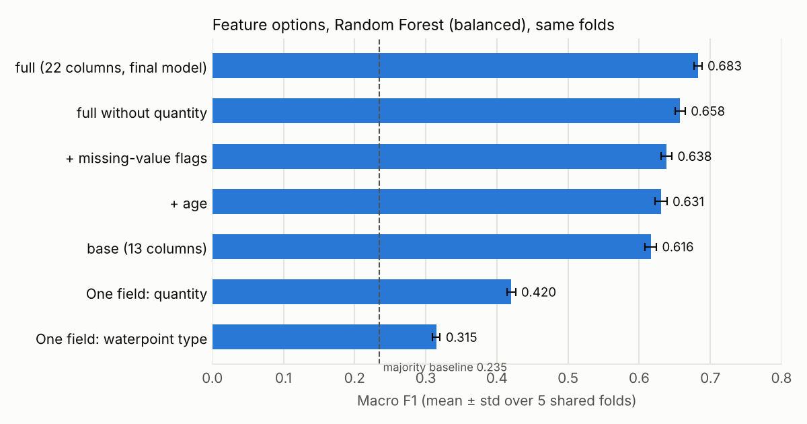
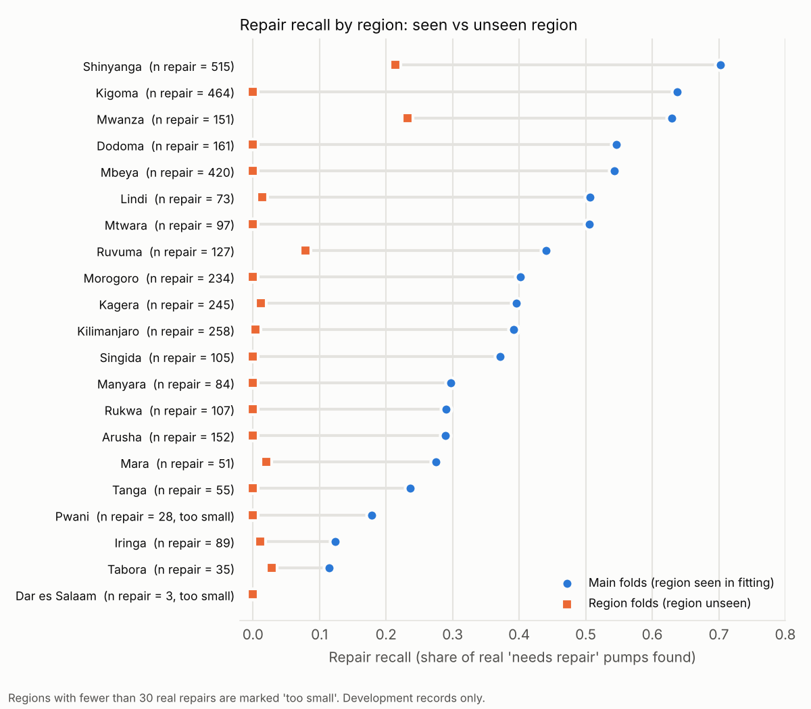

# Feature and location checks (PM-3, Issue #16)

PM-3, issue [#16](https://github.com/marblehub/data-circle/issues/16), cards 13–17.
Run on 15 November 2026 with the #17 final setup: Random Forest,
`class_weight="balanced"`, 300 trees, seed 42. Development records only
(47,520 in five shared folds from `sprint2_splits.csv`). The labelled holdout
was not scored.

Code: `src/team_wtm/feature_checks.py` (reuses PM-1 `evaluation.py`, PM-4
`model_comparison.py`, PM-3 `features.py`) and `feature_check_charts.py`.

## Result in short

- **Location is the most useful added group.** Macro F1 rises from 0.616
  (`base`) to 0.683 (`full`). Age adds +0.015, missing-value flags +0.007
  (less than one fold standard deviation) and location +0.045.
- **H6 is supported.** One field alone is far weaker than the combined groups:
  quantity 0.420 and waterpoint type 0.315, against 0.683 for `full`.
- **The model does not transfer to unseen regions.** When whole regions are
  held out, macro F1 falls from 0.683 to 0.489 and repair recall from 0.49 to
  0.04. The main cross-validation score describes regions that are already in
  the data, not new areas.
- **Known vs unknown age cannot be separated from region.** About 95% of
  unknown ages are in six regions, so this comparison mostly compares regions.

## 1. Feature ladder (card 13)

Each step adds one group. Same model, same folds. Mean ± sample std over five folds.

| Features | Columns | Macro F1 | Change | Repair recall | Repair precision | False repair alarms |
| --- | ---: | ---: | ---: | ---: | ---: | ---: |
| base | 13 | 0.616 ± 0.008 | | 0.510 | 0.252 | 1,048 |
| + age | 15 | 0.631 ± 0.008 | +0.015 | 0.522 | 0.263 | 1,014 |
| + missing-value flags | 18 | 0.638 ± 0.008 | +0.007 | 0.529 | 0.278 | 949 |
| + location (`full`) | 22 | 0.683 ± 0.005 | +0.045 | 0.489 | 0.383 | 545 |

- Age gives a small gain (about two fold standard deviations).
- Missing-value flags give less than one fold standard deviation, so their
  value is not shown clearly.
- Location gives the largest gain, mainly by cutting false repair alarms.
  Section 4 shows that this gain depends on the region being in the training data.

## 2. Quantity (card 14)

Run by PM-4 in #17 with the PM-3 options; repeated here for completeness.
Removing `quantity` and `quantity_group` together lowers macro F1 from 0.683 to
0.658 (3–5 fold standard deviations). Quantity adds real information. Whether it
is known before an inspection is **not confirmed**; it describes the inspected
condition. If it is not available at prediction time, PM-4's plan B
(`full_no_quantity`) applies. Possible leakage is a concern, not a proven fact.

## 3. One field vs combined groups, H6 (card 15)

| Features | Macro F1 | Accuracy | Repair recall | Repair precision | False repair alarms |
| --- | ---: | ---: | ---: | ---: | ---: |
| full (combined groups) | **0.683 ± 0.005** | 0.779 | 0.489 | 0.383 | 545 |
| One field: quantity | 0.420 ± 0.006 | 0.507 | 0.432 | 0.097 | 2,765 |
| One field: waterpoint type | 0.315 ± 0.005 | 0.321 | 0.691 | 0.084 | 5,184 |

The two single fields were chosen as the strongest one-field associations in
Sprint 1 (Cramér's V 0.31 and 0.25). Combined groups beat both by more than
0.26 macro F1. **H6 is supported.** The high repair recall of waterpoint type
alone is not useful: balanced class weights make the model call many pumps
"needs repair", which gives about 5,200 false alarms per fold.

## 4. Train on some regions, validate on others (card 17)

**How this split differs from the main split.** The main folds only keep
identical records together, so pumps from the same region (often close
neighbours) are in both fitting and validation. Here, `GroupKFold` puts each
region in exactly one of five folds. The validation regions are never seen
during fitting. Only development records are used.

| Split | Macro F1 | Accuracy | Repair recall | Repair precision |
| --- | ---: | ---: | ---: | ---: |
| Main folds (region seen in fitting) | 0.683 ± 0.005 | 0.779 ± 0.005 | 0.489 ± 0.013 | 0.383 ± 0.012 |
| Region folds (region unseen) | 0.489 ± 0.037 | 0.691 ± 0.058 | 0.036 ± 0.039 | 0.160 ± 0.186 |

| Fold | Validation regions | Macro F1 | Real repairs | Missed |
| ---: | --- | ---: | ---: | ---: |
| 0 | Iringa, Mara, Rukwa, Ruvuma | 0.532 | 374 | 362 |
| 1 | Kigoma, Shinyanga, Singida, Tabora | 0.526 | 1,119 | 1,008 |
| 2 | Dodoma, Mbeya, Mtwara, Mwanza | 0.457 | 829 | 794 |
| 3 | Kagera, Kilimanjaro, Lindi, Tanga | 0.464 | 631 | 626 |
| 4 | Arusha, Dar es Salaam, Manyara, Morogoro, Pwani | 0.465 | 501 | 501 |

- In unseen regions the model found **163 of 3,454** pumps that need repair.
  It still separates functional and non-functional pumps partly (accuracy 0.69).
- In 17 of 21 regions, repair recall drops to 0.00–0.02 once the region is unseen.
  Only Mwanza (0.23), Shinyanga (0.21), Ruvuma (0.08) and Tabora (0.03) keep some.
- Possible reasons, **not tested here**: the share of pumps needing repair
  differs strongly by region (0.5% in Dar es Salaam to 21% in Kigoma); an unseen
  region has no learned region category; and nearby pumps look alike. No causal
  claim is made.

## 5. Results by region and by age (card 16)

Out-of-fold predictions of the final setup on the main folds. Check: the mean
fold macro F1 is 0.6828, identical to #17. Groups with fewer than 30 real
repairs are flagged (D20) and kept in the tables.

**By age availability**

| Age | Records | Real repairs | Macro F1 | Repair recall | Missed repairs | False alarms |
| --- | ---: | ---: | ---: | ---: | ---: | ---: |
| known | 30,914 | 2,007 | 0.686 | 0.446 | 1,112 | 1,432 |
| unknown | 16,606 | 1,447 | 0.671 | 0.549 | 653 | 1,292 |

Unknown age is mostly a regional group: Dodoma, Kagera, Mbeya, Shinyanga,
Mwanza and Tabora. Only Mwanza and Shinyanga have at least 30 real repairs in
both age groups, and their known-age groups are small (53 and 57 repairs). So
**the effect of unknown age cannot be separated from region** with this data,
and age (H1) cannot be assessed in Dodoma, Kagera, Mbeya and Tabora at all.

**By region** (main folds; full table in `pm3_groups_by_region.csv`)

- Repair recall ranges from 0.11 (Tabora) and 0.12 (Iringa) to 0.70 (Shinyanga).
- Regions with few repairs tend to have low repair recall.
- **Too small for reliable repair conclusions:** Dar es Salaam (3 repairs) and
  Pwani (28). In the region × age table, most unknown-age cells outside the six
  regions above are too small.

## Recommendations for the final decision

1. Keep `full` as the final features; every group except the missing-value
   flags shows a clear gain.
2. Report the 0.683 macro F1 as **performance in regions already surveyed**.
   Do not claim the model works in a new region: there it misses almost every
   repair.
3. For maintenance planning, use the model within surveyed regions. For a new
   area, collect some labelled inspections there first.
4. Confirm whether `quantity` is known at prediction time (PM-1, PM-4).

## Limitations

- One model setup, no tuning; region folds are five fixed groupings of 4–5 regions.
- Region folds use fewer and differently mixed regions for fitting, which
  also changes the class balance the model sees.
- Development data only; the holdout was not used for any of these checks.
- Associations only. No result here shows why a pump fails.

## Files

Aggregate tables in `reports/sprint2/`: `pm3_ladder_*`, `pm3_h6_*`,
`pm3_groups_by_region.csv`, `pm3_groups_by_age.csv`,
`pm3_groups_by_region_age.csv`, `pm3_groups_summary.json`,
`pm3_region_cv_scores.csv`, `pm3_region_comparison_table.csv`,
`pm3_region_transfer_by_region.csv`, `pm3_region_summary.json`.
Individual predictions stay local in `data/processed/` (ignored by Git).
